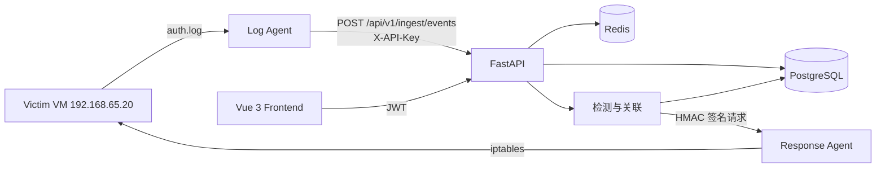

# MiniSOC

轻量级安全运营与应急响应平台。

MiniSOC 自己实现了一条安全运营闭环：

```text
日志采集 → 标准化 → 规则检测 → 告警去重 → 事件关联 → 响应处置 → 审计
```

它不是把 Wazuh/ELK 装起来，而是自己实现了日志接入、检测引擎、告警关联、事件工单和自动响应链路。

## 功能

- Linux `auth.log` 日志采集，Agent 支持 offset 断点续传
- API Key 鉴权的事件接入接口
- SSH 暴力破解检测：同一来源 IP 5 分钟内失败 ≥ 5 次
- 告警去重：同一规则、实体、时间窗口只保留一条告警，更新 `count`
- Incident 事件工单：同实体 10 分钟内多条告警自动关联
- 告警详情可回溯原始 Event 证据
- JWT 登录 + RBAC：`admin / analyst / viewer`
- 自动响应：高危 SSH 爆破告警自动调用响应 Agent 封禁来源 IP
- 响应 Agent 安全设计：HMAC 签名、时间戳防重放、IP 白名单、独立 iptables 链、dry-run、审计日志
- Vue 3 前端：登录、告警中心、告警详情、事件工单、响应记录

## 架构



更详细的架构、数据模型、检测逻辑和失败模式见 [docs/architecture.md](docs/architecture.md)。

## 技术栈

| 层 | 技术 |
|---|---|
| 后端 | Python 3.11、FastAPI、SQLAlchemy 2.0、Pydantic v2 |
| 数据库 | PostgreSQL 16 |
| 缓存 | Redis 7 |
| 前端 | Vue 3、Vite、Element Plus |
| 部署 | Docker Compose |
| 日志 Agent | Python 标准库，offset 断点续传 |
| 响应 Agent | Python 标准库 HTTP Server、iptables、HMAC |
| 测试/验证 | Paramiko、真实 SSH 密码爆破、合成事件 |

## 快速启动

### 0. 环境变量

```bash
cd deploy
cp .env.example .env
```

编辑 `deploy/.env`，设置数据库密码、`API_KEY`、`JWT_SECRET`、管理员密码和 `RESPONSE_AGENT_SECRET`。

`deploy/.env` 已被 `.gitignore` 排除，不要提交真实密钥。

### 1. 后端

```bash
cd deploy
docker compose up -d --build
curl -sS http://localhost:8000/health
```

### 2. 前端

```bash
source ~/minisoc/scripts/node_path.sh
cd frontend
npm install
npm run dev
```

访问：

```text
http://192.168.65.10:5173
```

开发环境账号：

使用 `deploy/.env` 中的 `ADMIN_USERNAME` / `ADMIN_PASSWORD` 登录。  
首次启动会自动创建管理员账号。

### 3. Victim 日志 Agent

在 Victim 上执行：

```bash
MINISOC_LOG_FILE=/var/log/auth.log \
MINISOC_API_URL=http://192.168.65.10:8000 \
MINISOC_API_KEY=<API_KEY from deploy/.env> \
python3 ~/agent.py
```

### 4. 响应 Agent

在 Victim 上以 root 运行：

```bash
sudo env MINISOC_RESPONSE_SECRET=<RESPONSE_AGENT_SECRET from deploy/.env> \
  MINISOC_RESPONSE_DRY_RUN=0 \
  python3 /home/victim/response_agent.py
```

默认 `MINISOC_RESPONSE_DRY_RUN=1`，只模拟不执行 iptables。

## API

| 方法 | 路径 | 认证 | 说明 |
|---|---|---|---|
| POST | `/api/v1/auth/login` | 无 | 用户登录，返回 JWT |
| GET | `/api/v1/auth/me` | JWT | 当前用户 |
| POST | `/api/v1/auth/users` | admin | 创建用户 |
| POST | `/api/v1/ingest/events` | API Key | 上报事件 |
| GET | `/api/v1/alerts` | JWT | 告警列表，支持 severity/status/limit/offset |
| GET | `/api/v1/alerts/{id}` | JWT | 告警详情 + 原始证据 |
| GET | `/api/v1/incidents` | JWT | 事件工单列表 |
| GET | `/api/v1/incidents/{id}` | JWT | 事件工单 + 关联告警 |
| GET | `/api/v1/actions` | JWT | 响应审计记录 |

## 检测逻辑

### SSH 暴力破解

- 数据源：`auth.log` 中的 `Failed password`
- 条件：同一来源 IP、5 分钟窗口内失败次数 ≥ 5
- 告警去重键：`ssh_bruteforce:{src_ip}:{5分钟桶}`
- 同一窗口重复触发只更新 `count` 和 `last_seen`

### 事件工单关联

- 条件：同一 `entity`、10 分钟窗口内 ≥ 2 条告警
- 结果：生成 Incident，并通过 `incident_alerts` 关联多条告警
- 已有 Incident 会复用，避免重复创建

## 验证结果（本地单机靶场）

- 真实 SSH 爆破：6 次失败登录触发 1 条高危 Alert，`count=6`
- 最后一条失败日志到告警创建：约 **8.2 秒**
- 告警创建到响应审计落库：约 **0.017-0.038 秒**
- 自动响应成功在 Victim 的 `MINISOC_BLOCK` 链写入 DROP 规则，并可在测试后解封
- 以上为本地单机验证数据，不是生产压测结果

## 安全设计

- Agent 接入使用 API Key，用户登录使用 JWT，二者职责分离
- 密码使用 bcrypt 哈希，不存明文
- RBAC 最小权限：viewer / analyst / admin
- 响应 Agent 使用 HMAC-SHA256 签名 + 时间戳，防伪造和重放
- 响应 Agent 白名单保护 SOC、Victim 和 localhost
- 独立 iptables 链 `MINISOC_BLOCK`，方便清理
- 响应默认 dry-run，执行动作写本地审计日志和 SOC `response_actions` 表

## 密钥管理

所有密钥通过 `deploy/.env` 注入，`.env` 已加入 `.gitignore`。  
`deploy/.env.example` 只包含占位符，不包含真实密钥。

历史提交中的 `dev-*` 字符串仅为早期本地开发占位，不是生产密钥；当前版本已全部改为环境变量。

## 当前限制

- 检测和响应目前是同步执行，生产环境应改为消息队列/Worker 异步处理
- 单机部署，无高可用
- 尚未接入 Alembic 数据库迁移
- 开发环境使用默认密码和 JWT secret，生产必须更换
- 当前只覆盖 SSH 爆破，Web 攻击和主机进程检测是后续路线
- 前端使用 `localStorage` 存 JWT，生产建议 HttpOnly Cookie
- 尚未配置 HTTPS、登录限流和完整自动化测试

## 后续路线

- [ ] Kali VM + DVWA，补充 SQL 注入、Web 扫描、反弹 Shell 场景
- [ ] Nginx access log 与 auditd 解析器
- [ ] Celery/Worker 异步检测与响应
- [ ] Alembic 数据库迁移
- [ ] 前端响应记录筛选和详情
- [ ] 指标统计：MTTD、误报率、检测覆盖率
- [ ] Demo 视频和简历包装

## 目录结构

```text
backend/          FastAPI 后端
frontend/         Vue 3 前端
agent/            日志采集 Agent
response-agent/   响应 Agent
lab/              靶场与攻击脚本
deploy/           Docker Compose
docs/             架构、演示、面试文档
scripts/          开发辅助脚本
```

## 安全说明

所有扫描、攻击和自动响应仅允许在本项目的隔离靶场中执行，禁止对未授权目标使用。
