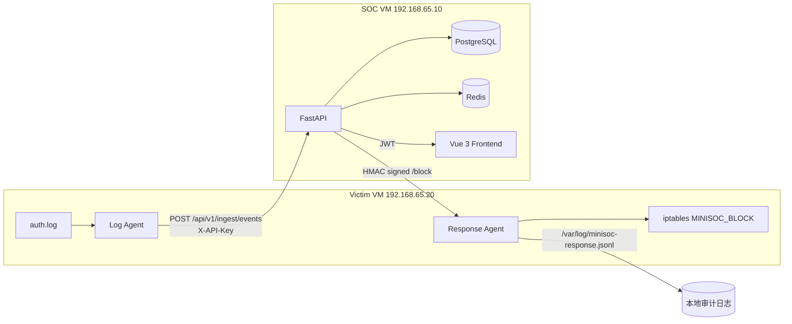
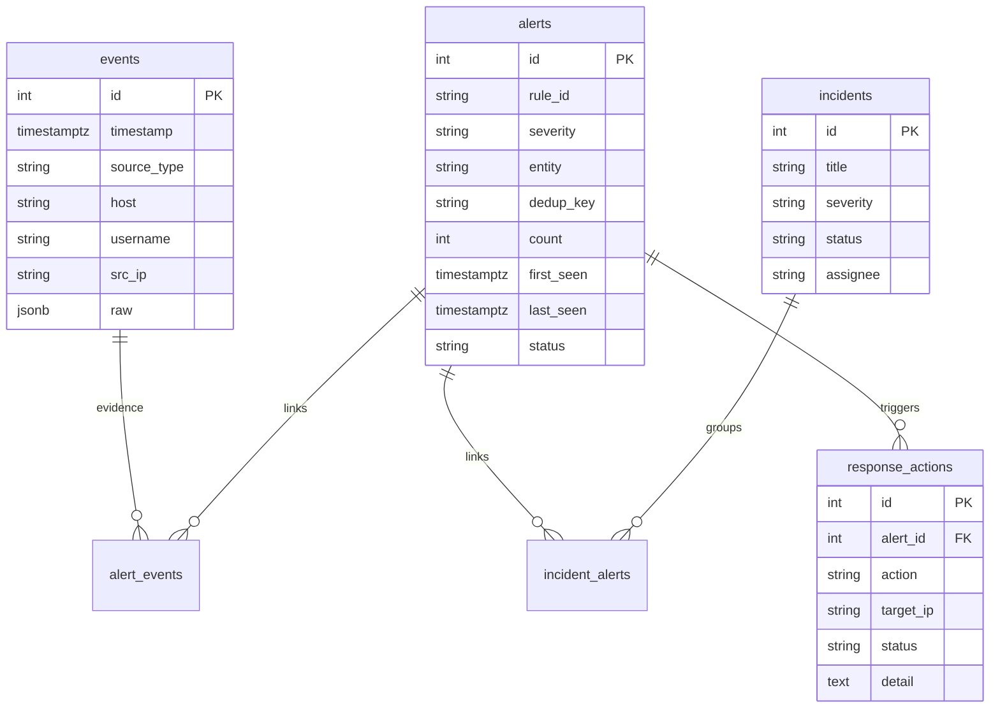

# MiniSOC 架构说明

## 1. 目标

MiniSOC 的目标是实现一条可验证的安全运营闭环：

```text
采集 → 标准化 → 检测 → 告警去重 → 事件关联 → 响应 → 审计
```

项目重点不是“把安全产品装起来”，而是理解并实现：

- 日志如何变成 Event
- 规则如何把 Event 变成 Alert
- Alert 如何去重和关联
- 多条 Alert 如何形成 Incident
- 高危告警如何自动响应
- 响应动作如何安全执行并留痕

## 2. 组件



### SOC

- FastAPI：认证、事件接入、告警/事件/响应查询
- PostgreSQL：事件、告警、工单、用户、响应审计
- Redis：当前用于健康检查和后续异步任务扩展
- Vue 3：登录、告警、事件工单、响应记录

### Victim

- 日志 Agent：读取 `auth.log`，解析 SSH 登录失败/成功，批量上报
- 响应 Agent：接收 SOC 的签名指令，执行 iptables 封禁/解封
- iptables：使用独立链 `MINISOC_BLOCK`，只影响目标 IP

## 3. 网络

| VM | IP | 网络 |
|---|---|---|
| SOC | 192.168.65.10 | NAT + 仅主机 |
| Victim | 192.168.65.20 | 仅主机 |
| Windows 攻击端 | 192.168.65.1 | 仅主机 |

SOC 和 Victim 通过仅主机网络通信；NAT 只用于安装软件和拉镜像。

## 4. 数据流

### 日志接入

```text
Victim auth.log
  → Log Agent 读取新增行
  → 解析为 Event JSON
  → POST /api/v1/ingest/events
  → API Key 校验
  → 写入 events 表
```

Agent 维护 offset 状态文件，只有发送成功才推进 offset。发送失败时下一轮会重试，因此语义是“至少一次”。

### 检测

```text
events
  → 规则检测
  → 命中生成 Alert
  → 告警去重
  → 关联 Incident
  → 自动响应
```

## 5. 数据模型



### 三层模型

- Event：原始证据，不可变，保留 `raw`
- Alert：规则命中结果，可去重、更新次数
- Incident：多条相关告警组成的工单

关联表：

- `alert_events`：Alert ↔ Event
- `incident_alerts`：Incident ↔ Alert

## 6. 检测与关联

### SSH 爆破

- 数据源：`auth.log` 的 `Failed password`
- 条件：同一 `src_ip` 在 5 分钟内失败次数 ≥ 5
- 去重键：`ssh_bruteforce:{src_ip}:{5分钟桶}`
- 重复触发只更新 `count`、`last_seen`

### Incident 关联

- 条件：同一 `entity` 在 10 分钟内出现 ≥ 2 条告警
- 已有 Incident 复用，不重复创建
- 通过 `incident_alerts` 关联所有相关告警

## 7. 自动响应

```text
Alert（高危 SSH 爆破）
  → auto_block_alerts()
  → HMAC-SHA256 签名请求
  → POST http://192.168.65.20:9000/block
  → Response Agent 验证签名/时间戳/白名单
  → iptables -I MINISOC_BLOCK -s IP -j DROP
  → 返回结果
  → SOC 写入 response_actions
  → Victim 写 /var/log/minisoc-response.jsonl
```

### 安全控制

- HMAC 签名：防止未授权调用
- 时间戳窗口 60 秒：防重放
- IP 白名单：禁止封 SOC、Victim、localhost
- 独立 iptables 链：方便解封和清理
- dry-run：默认只模拟
- 双份审计：Victim 本地日志 + SOC 数据库

## 8. 失败模式

| 故障 | 当前行为 |
|---|---|
| Agent 发送失败 | offset 不前进，下一轮重试 |
| 检测异常 | 当前同步流程会导致本次接入失败；生产应解耦 |
| 响应 Agent 不可达 | Alert 保留，`response_actions` 记为 error |
| PostgreSQL 不可用 | `/health` 降级，写入和查询失败 |
| Redis 不可用 | `/health` 降级，后续异步任务不可用 |

## 9. 扩展路径

### 日志量增长

- 接入 Redis Streams/Kafka
- 检测和响应改为 Celery/Worker
- 事件存储切换 ClickHouse/OpenSearch
- 按时间分区 + 保留策略

### 检测能力

- 接入 Nginx、auditd、Suricata
- 支持 Sigma 子集规则
- 增加 Web 扫描、SQLi、反弹 Shell、Cron 持久化规则
- 规则测试集与误报基线

### 安全加固

- HTTPS / mTLS
- 专用低权限响应服务账号
- 登录限流、JWT 刷新与撤销
- HttpOnly Cookie 替代 localStorage
- Alembic 数据库迁移
- CI：lint、测试、依赖审计

## 10. 关键取舍

- 不用 ELK：笔记本资源有限，项目重点是检测闭环而不是搜索集群工程
- 用 PostgreSQL：项目规模足够，JSONB 能保留原始日志；扩展路径清晰
- 同步检测/响应：MVP 简单可验证，生产改为异步
- 自研 Agent：便于理解 offset、批量、重试和解析，而不是只调工具
- 响应 Agent 窄接口：比让 SOC 直接 SSH 执行 root 命令更安全
